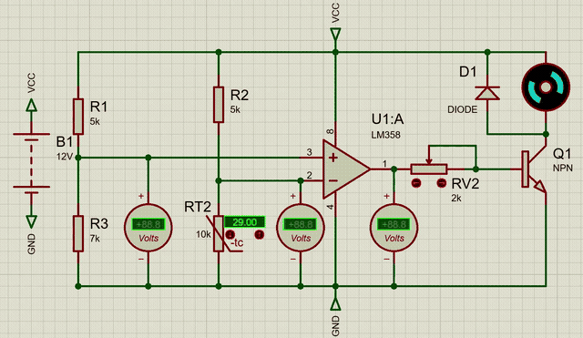
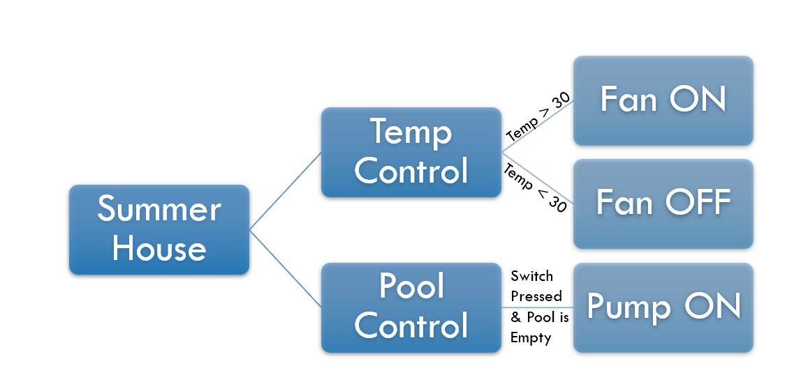
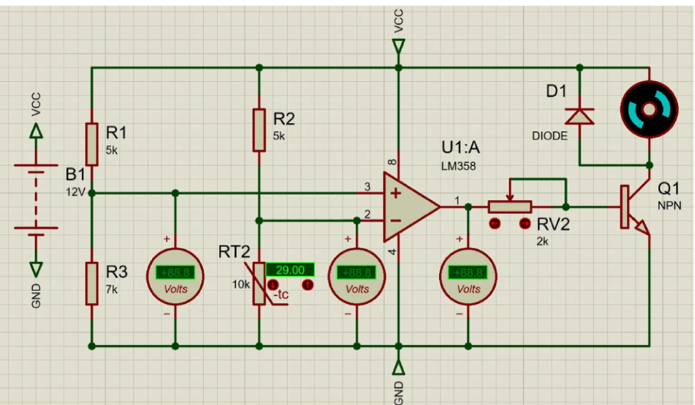
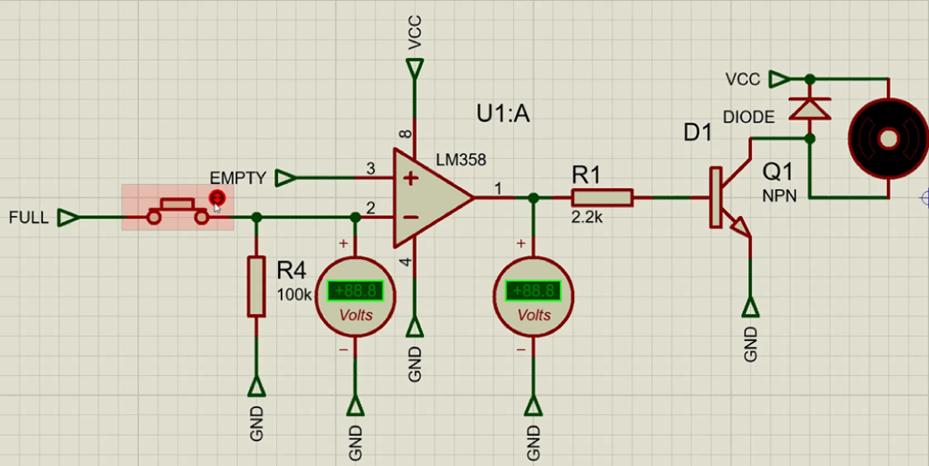
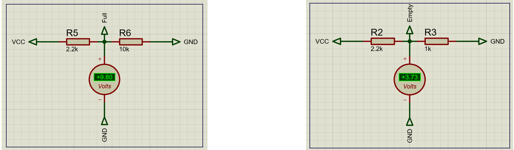
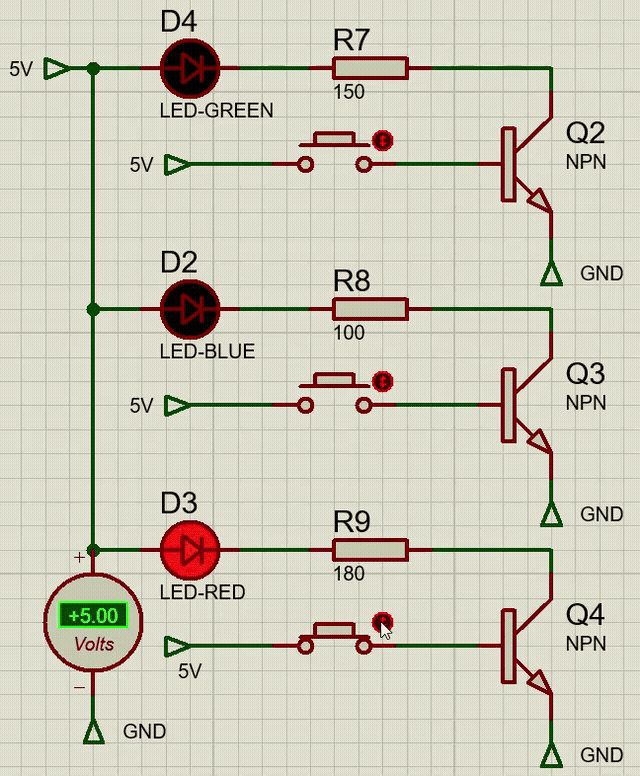

# 🏠 Summer House: Analog Smart Home Automation

**Automating a model house with op-amp comparators and transistor switches, with no microcontroller.**

A temperature-controlled cooling fan, an automatic pool-filling pump, and a water-level indicator, designed, simulated in Proteus, and built as a physical model.



---

## 📌 At a Glance

| | |
|---|---|
| **Course** | CCE 201L: Circuit Analysis I Lab, American University of Science & Technology (AUST) |
| **Date** | August 2026 |
| **Team** | 4 students |
| **My role** | Designed and simulated the control circuits in Proteus; designed the project poster |
| **Tools** | Proteus, LM358 op-amp, NTC thermistor, 2N3904 NPN transistors |
| **Status** | ✅ Simulated · ✅ Built as a physical model |

---

## 🎯 Problem & Goal

Basic home automation tasks like switching on a fan when it gets hot or refilling a pool when it's empty are usually done with a microcontroller. This project shows that **simple analog electronics can make these decisions on their own**, with lower cost and less complexity.

**Objectives:**
1. Turn a cooling fan **ON automatically when the temperature exceeds 30 °C**
2. Run a pool pump **only when the fill switch is pressed AND the pool is empty**
3. Show the water level with **three LEDs** (Red = empty, Blue = medium, Green = full)

---

## 🧩 System Architecture



| Subsystem | Input | Decision | Output |
|---|---|---|---|
| Temperature control | NTC thermistor | LM358 comparator vs. fixed reference | 5 V DC fan via NPN switch |
| Pool pump | Fill switch + level reference | LM358 comparator (switch AND empty) | 12 V DC pump via NPN switch |
| Water-level indicator | Level switches | NPN transistor switches | Red / Blue / Green LEDs |

---

## ⚙️ How It Works

### 1. Temperature-Controlled Fan



- **Reference (V+, pin 3):** voltage divider R1 = 5 kΩ / R3 = 7 kΩ from 12 V gives about **7 V**
- **Sensing (V−, pin 2):** R2 = 5 kΩ in series with a **10 kΩ NTC thermistor**. As temperature rises, thermistor resistance falls and V− drops.
- **Decision:** when V+ > V−, the LM358 output goes HIGH and drives transistor Q1 through RV2 (2 kΩ), which switches the fan on
- **Protection:** flyback diode D1 across the motor absorbs inductive voltage spikes

**Measured in simulation at 31 °C:** V+ = 6.94 V, V− = 6.78 V → output = **10.6 V (fan ON)**.
At 29 °C, V− stays above V+ → output = 0 V (fan OFF).

### 2. Automatic Pool Pump





- Two voltage dividers represent the pool level: **FULL = +9.80 V** (R5 = 2.2 kΩ / R6 = 10 kΩ) and **EMPTY = +3.73 V** (R2 = 2.2 kΩ / R3 = 1 kΩ)
- The comparator compares EMPTY (pin 3) with FULL through a push-button and a 100 kΩ pull-down (pin 2)
- When the switch is pressed and the pool is empty, the output goes HIGH, current flows through R1 = 2.2 kΩ into Q1, and the **12 V pump runs**
- Flyback diode protects the transistor


### 3. Water-Level Indicator


Three independent 2N3904 transistor branches on a 5 V rail:

| Level | LED | Current-limit resistor | Transistor |
|---|---|---|---|
| Full | 🟢 Green | 150 Ω | Q2 |
| Medium | 🔵 Blue | 100 Ω | Q3 |
| Empty | 🔴 Red | 180 Ω | Q4 |



---

## 🔩 Components

| Component | Part | Role |
|---|---|---|
| Op-amp | LM358 (dual, single-supply) | Voltage comparator for fan and pump |
| Temperature sensor | NTC thermistor 10 kΩ (103) | Senses room temperature |
| Transistors | 2N3904 NPN | Switches for motors and LEDs |
| Fan | 5 V DC brushless | Active cooling |
| Pump | 12 V DC brushless | Fills the pool |
| Diodes | Flyback diodes | Protect transistors from motor spikes |
| Resistors | Fixed + potentiometers | Reference dividers, base and LED current limits |

---

## ✅ Results

- ✅ Fan switches **ON above 30 °C** and **OFF below**
- ✅ Pump runs **only** when the switch is pressed **and** the pool is empty
- ✅ All three LED level indicators work correctly
- ✅ All circuits verified in Proteus simulation, then built as a physical model

<!-- 📸 ADD PHOTOS OF THE REAL MODEL HERE

-->

---

## 🧠 What I Learned

- Using an op-amp **without feedback as a comparator** to make analog decisions
- Designing **voltage dividers** to set precise threshold and reference voltages
- Driving motors safely with **transistor switches and flyback diodes**
- Going from **schematic → simulation → physical build**

---

## 🚀 Future Improvements

- Add a **microcontroller** (Arduino / PIC) for programmable thresholds and smarter logic
- Add **hysteresis** (Schmitt trigger) so the fan doesn't flicker on and off near 30 °C
- Use **real water-level sensors** instead of switches
- **PID temperature control** with variable fan speed (PWM)
- A mobile or web dashboard for monitoring

---

## 📁 Repository Contents

```
summer-house-automation/
├── README.md
├── docs/
│   ├── Summer_House_Report.pdf   ← full technical report
│   └── poster.png                ← project poster
├── images/                       ← schematics, diagrams, simulation GIFs
└── videos/                       ← full simulation recordings (.mp4)
```

📄 **[Read the full report (PDF)](docs/Summer_House_Report.pdf)** · 🖼️ **[View the poster](docs/poster.png)**

---

## 👥 Team

Ahmad Abou Ilawi · Lama Al Sayed · Maya Shaib · **Shaza Hamzeh**
**Advisor:** Mohamad Hamza
Department of Mechatronics / Computer & Communications Engineering, AUST, Zahleh Campus

## 📚 References

1. Sedra, A. S., & Smith, K. C., *Microelectronic Circuits*, 8th ed., Oxford University Press, 2020.
2. Rashid, M. H., *Power Electronics: Circuits, Devices, and Applications*, 4th ed., Pearson, 2014.
3. Texas Instruments, *LM358 Low-Power Dual Operational Amplifiers Datasheet* (SLOS068).
